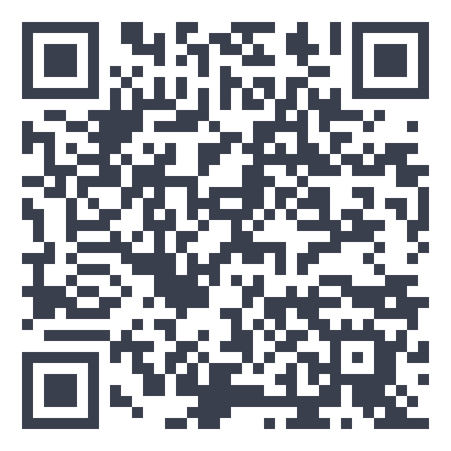

# SoyTigreYa

**Beneficios Soy Tigre, comercio de barrio y trámites municipales en una sola app.**

Prototipo funcional del Trabajo Final Integrador de la **Diplomatura en Negocios Digitales e Innovación** (Universidad Nacional del Delta, 2026). Autora: Milagros Sanabria.

👉 **Probala en vivo:** https://mila-ops-ia.github.io/soytigreya


Se puede instalar en el celular: en Android, menú ⋮ › "Instalar app"; en iPhone, Compartir › "Agregar a inicio".

> ⚠️ **Prototipo académico.** No es una app oficial del Municipio de Tigre ni está vinculada con él. Los comercios, las personas y los números son de demostración. Usa la identidad visual pública del municipio solo como referencia para la propuesta.

---

## La idea

SoyTigreYa es el upgrade de la app **Soy Tigre**: a la tarjeta de beneficios que ya existe le suma comprar en el barrio, trámites y medición.

- **Comercio de cercanía sin comisión.** Los comercios venden con retiro en el local o con envío de su propio cadete, sin pagar la comisión de las apps de delivery (25% en promedio, hasta 35% con reparto), y el descuento Soy Tigre se aplica solo.
- **Trámites y servicios del vecino.** Turnos, reclamos con foto y mapa, pagos de tasas, multas y estacionamiento, altura del río, colectivos, farmacias de turno y botón de alerta.
- **Datos para el municipio.** Paneles estilo CRM: casos de reclamos por estado y urgencia, comercios como cuentas, ventas por localidad y proyección financiera.

## Cuatro perfiles

Al entrar se elige con quién recorrer la app:

| Perfil | Rol | Qué ve |
|---|---|---|
| 👩🏻 Lucía | Vecina de Tigre Centro | La app del celu: beneficios, compras, trámites, Puntos Tigre y la asistente Tigri |
| 👩🏻‍🍳 Rosa | Dueña de Pastas Doña Rosa | El panel de su local, estilo CRM: pedidos en tablero o lista, clientes, reclamos, productos, envío propio y ventas |
| 👨🏽‍💼 Carlos | Atención al Vecino | Los reclamos como casos, por estado y urgencia, el mapa, las cuadrillas y los turnos del día |
| 👩🏽‍💼 Marina | Desarrollo Económico | El impacto: ventas, comercios como cuentas, finanzas y territorio |

El botón **"▶ Ver el recorrido guiado"** muestra, en 10 pasos, cómo un pedido y un reclamo pasan por las cuatro personas.

## Funciones principales

- Credencial digital con QR que cambia cada 30 segundos
- Beneficios en lista y mapa (OpenStreetMap)
- Compra con descuento automático, retiro en el local o envío con el cadete del comercio a la ubicación del celular (sin escribir la dirección), con hora de llegada, aviso de demora y código de entrega
- Pagos simulados con Mercado Pago, Cuenta DNI, tarjeta o efectivo
- **Puntos Tigre:** se suman al comprar en el barrio, pagar la tasa a tiempo, reciclar y por reclamos resueltos. Se canjean por cupones, descuento en la tasa, estacionamiento o entradas culturales
- **Tigri:** asistente de chat que entiende frases como "quiero pizza", "hay un bache" o "farmacia de turno". Por ahora funciona con reglas, y en la etapa 3 se conectaría a inteligencia artificial
- **Salud, deporte y trabajo:** turnos médicos en la red municipal, escuelas deportivas y colonia, búsquedas laborales y cursos
- **Lo propio de Tigre:** altura del río con pronóstico y aviso de crecida, botón de alerta que envía la ubicación, colectivos, farmacias de turno, eventos culturales y puntos verdes
- Modo de letra grande y alto contraste
- Versión de escritorio y app instalable (PWA) que abre sin conexión

## Documentos

- [Home con todos los enlaces](https://mila-ops-ia.github.io/soytigreya/enlaces.html)
- [Presentación](https://mila-ops-ia.github.io/soytigreya/presentacion/): portada, 4 diapositivas y cierre. Flechas para avanzar, F pantalla completa ([PDF](documentos/Presentacion%20-%20SoyTigreYa.pdf)). La versión extendida de 9 está en presentacion/completa.html
- [Trabajo Final Integrador (PDF)](documentos/Trabajo%20Final%20Integrador%20-%20SoyTigreYa.pdf): 8 hojas contando la portada ([Word](documentos/Trabajo%20Final%20Integrador%20-%20SoyTigreYa.docx))
- [Anexos del trabajo (PDF)](documentos/Anexos%20-%20SoyTigreYa.pdf): herramientas, fórmulas, escenarios, hoja de ruta y fuentes
- [Folleto de una hoja (PDF)](documentos/Folleto%20-%20SoyTigreYa.pdf)
- [Pitch de 5 minutos (PDF)](documentos/Speech%20-%20SoyTigreYa.pdf)
- [Instructivos de uso para cada perfil (PDF)](documentos/Instructivos%20de%20uso%20-%20SoyTigreYa.pdf)
- [Formulario de opiniones](https://docs.google.com/forms/d/e/1FAIpQLSdKRXBPEiUi4mCrS9Q42NO-v4DuR-QqupuJ9cMIeXA5iHMqNg/viewform)

## Cómo está hecha

- HTML, CSS y JavaScript sin frameworks ni proceso de compilación
- [Leaflet](https://leafletjs.com) + OpenStreetMap para los mapas y [qrcode-generator](https://github.com/kazuhikoarase/qrcode-generator) para los QR
- Datos de demostración guardados en el navegador (`localStorage`). Cada aparato tiene su propia demo; "Reiniciar los datos de la demo" vuelve al inicio
- Colores del Municipio de Tigre (rojo `#D02013`, gris pizarra `#515769`) y tipografía Montserrat

```
index.html      la app
css/app.css     estilos
js/data.js      datos de demo: comercios, beneficios, perfiles, puntos
js/app.js       lógica, pantallas, Tigri y recorrido guiado
manifest.json   instalación en el celu
sw.js           funcionamiento sin conexión
documentos/     trabajo escrito (PDF, Word y el script que lo genera), presentación e instructivos en PDF
capturas/       capturas de pantalla
```

Para verla en tu compu, desde esta carpeta:

```bash
python3 -m http.server 8450
```

y abrí http://localhost:8450.

## Fuentes de los datos

- Población de Tigre: Censo Nacional 2022 (446.925 habitantes)
- Comisiones de apps de delivery: Develop Argentina (marzo de 2026) e iProfesional (julio de 2026)
- Antecedentes en Rosario: MuniShop (tienda online sin comisión del Banco Municipal, 2023, hoy inactiva) y Coopexpress (cooperativa de cadetes)
- Costos de referencia: tarifas publicadas de Supabase y Mercado Pago (2026) y sueldos IT de Develop Argentina (junio de 2026)

## Créditos de fotos

Fotos de [Wikimedia Commons](https://commons.wikimedia.org), usadas según su licencia:

- Delta de Tigre: "Canales del Delta de Tigre 02", ProtoplasmaKid, CC BY-SA 4.0
- Puerto de Frutos: "Rio Lujan - Puerto de frutos (Localidad de Tigre)", Jorge Láscar, CC BY 2.0
- Pileta: "Public Swimming Pool in Melbourne VIC Australia", KeepActive Australia, CC BY-SA 4.0
- Gimnasio: "Woman in a gym sitting on the floor and doing dumbbell curls", Shixart1985, CC BY 2.0
- Veterinaria: "Dog portrait with a veterinarian in blue uniform holding a stethoscope", Nenad Stojkovic, CC BY 2.0
- Taller de soldadura: "Students practicing Welding at Workshop", Navinreddy23, CC BY-SA 3.0

Fotos de rubros en Beneficios (ilustrativas del rubro, no del local):

- Hamburguesa: "Homemade hamburger with french fries in Argentina", Horacio Cambeiro, CC BY-SA 3.0
- Café con medialunas: "Café y medialunas en Buenos Aires", Ivanmartinez, CC BY-SA 3.0
- Pet shop: "Pet goods shop - Arlington, MA", Daderot, CC0
- Bicicletería: "U Wash bicycle shop 02A", Joe Mabel, CC BY-SA 3.0
- Parque de la Costa: "Montaña rusa en el Parque de la Costa", Dario Alpern, CC BY-SA 3.0
- Restaurante junto al río: "J34 862 Restaurante Parrilla Fondeadero", Falk2, CC BY-SA 4.0
- Supermercado: "Shelves of Progresso products at the Giant supermarket in Kingstowne", Ser Amantio di Nicolao, CC BY-SA 4.0
- Cervecería: "Beer growler and personalized pub pint glasses (18496099018)", Personal Creations, CC BY 2.0

## Fuentes de las secciones nuevas

- Deporte: red de 18 polideportivos municipales, Polideportivo Sarmiento con la pista de atletismo "Abel Acevedo", Ñato Errecart en Benavídez, Microestadio Ciudad de Benavídez y colonia de verano (notas de Parlamentario, Letra P y Canal 26, 2019-2026).
- Trabajo y formación: Portal de Empleo del municipio (empleos.tigre.gob.ar), operativos Punto Empleo y Tigre Instituto Formativo con más de 870 cursos gratuitos (Parlamentario, 2026).
- Salud: Hospitales de Diagnóstico Inmediato Valentín Nores, Eduardo Mocoroa y Floreal Ferrara, Hospital Materno Infantil Florencio Escardó, hospitales Cardiovascular, Oftalmológico y Odontológico y 23 CAFyS (Parlamentario 2026, Ministerio de Salud PBA).
- Horarios, cupos, búsquedas laborales y especialidades por centro son datos de demostración.
- Beneficios Soy Tigre: comercios, direcciones, días y descuentos reales tomados de tigre.gob.ar/novedades (supermercados 13/09/2024, mascotas 30/04/2024, gastronomía 28/07/2025), Parlamentario (27/03/2026), Zona Norte Hoy (farmacias, 18/10/2026) y capturas de la app Tigre Municipio. Pueden haber cambiado.
- Comprar y reservar: los comercios de esa sección son de ejemplo, porque pedir por la app es una propuesta nueva del prototipo.
- Comparación de costos: Municipalidad de Santa Fe, Licitación Pública 1/2025 (presupuesto oficial $316 M; ofertas de $274,9 M y $284,4 M según FM Vintage); San Cayetano, app adjudicada por $85,7 M (Caynet, 2026); Ciudad de Buenos Aires, plataforma de trámites por $483,6 M (Voces de la Comuna 15); Billetera Santa Fe cofinanciada por comercios y Banco Santa Fe (Pausa y Mirador Provincial, nov. 2025); precios de agencias: Develop Argentina (2026).
